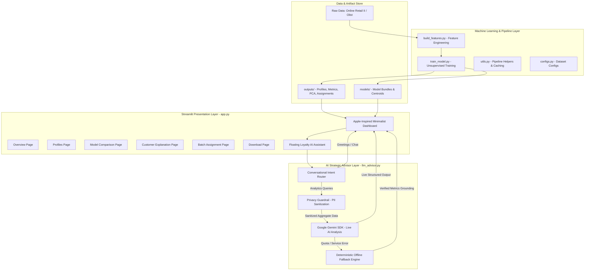
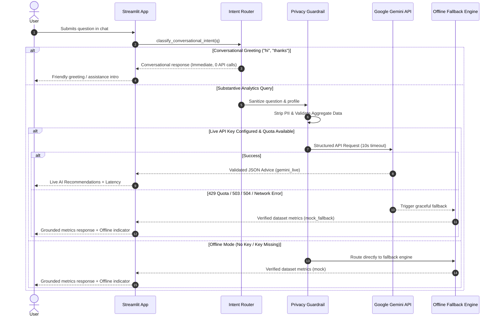

# System Architecture

## 1. Overview & Architectural Principles

The **E-Commerce Customer Loyalty Analytics** system is a production-grade, privacy-preserving analytical application designed for unsupervised customer segmentation, behavioral profiling, and data-grounded loyalty strategy formulation.

---

## 2. Component Architecture

### 2.1 Streamlit Presentation Layer (`app.py`)
- **Design System & Theme Management**: Apple-inspired minimalist aesthetic with dynamic **Light / Dark / System Appearance Switching**:
  - **Light Mode**: `#F5F5F7` soft off-white canvas, `#FFFFFF` card surfaces, `#1D1D1F` primary text, `#0071E3` accent blue, and `#E5E5EA` borders.
  - **Dark Mode**: `#0E1117` canvas, `#1E212A` card surfaces, `#F5F5F7` primary text, `#0A84FF` accent blue, and `#2F3440` borders.
  - **System Mode**: Uses `@media (prefers-color-scheme: dark)` media query for automatic real-time OS-level adaptation.
  - **Dynamic Theme Injection**: Injected CSS variables (`--bg-primary`, `--bg-surface`, `--text-primary`, `--text-secondary`, `--border-color`, `--accent-blue`) governing all cards, metrics, headers, inputs, and floating chat elements.
  - **Dark-Adapted Plotly Charts**: Centralized `show_chart()` function that injects dark layout properties (`#1E212A` plot background, `#F5F5F7` axis text, `#2F3440` grid lines) and selects `APPLE_PALETTE_DARK` vs `APPLE_PALETTE_LIGHT`.
- **Navigation**: Sidebar dataset switcher (`Online Retail II`, `Olist E-Commerce`) with 6 responsive page views:
  1. **Business Overview**: Population KPIs, revenue contribution, repeat customer rates, segment distribution bar charts, and comprehensive data-cleaning audit logs.
  2. **Customer Segment Profiles**: Segment comparison tables, multi-feature grouped bar charts, and aggregate segment-level AI recommendations.
  3. **Clustering Comparison & Model Selection**: Validation metrics (Silhouette, Davies-Bouldin, Calinski-Harabasz, ARI stability), PCA cluster projections, and algorithm sweeps.
  4. **Customer Explanation**: Customer-level lookup against population averages and segment behavioral profiles.
  5. **Batch Assignment**: Cached high-throughput scoring of unlabelled customer CSV files with validation and responsive previews.
  6. **Download Results**: Complete machine-readable JSON evaluation reports and CSV assignment tables.
- **Floating Chat Assistant**: Persistent bottom-right floating widget anchored above launcher button, providing real-time AI assistance across all dashboard pages.

### 2.2 Feature Engineering Pipeline (`build_features.py`)
- **Online Retail II**:
  - Handles multi-sheet transactional workbooks with Calamine and OpenPyXL engines.
  - Distinguishes positive sales lines from cancellations and returns (`Invoice` prefix 'C' or `Quantity < 0`).
  - Computes per-customer RFM, tenure, unique product count, average order value (AOV), average basket size, and empirical return rate.
- **Brazilian E-Commerce (Olist)**:
  - Resolves many-to-one and one-to-one joins across 6 normalized relational tables (`orders`, `customers`, `order_items`, `payments`, `reviews`, `products`).
  - Filters strictly for `delivered` orders to eliminate pipeline distortion from incomplete or cancelled shipments.
  - Aggregates at the order level first to ensure mathematical idempotence and eliminate double-counting of payment values.
  - Computes customer-level RFM, tenure, category diversity, review scores, installment patterns, and delivery delays.

### 2.3 Machine Learning & Model Selection (`train_model.py`)
- **Data Leakage Prevention**: Splits data into an 80% training partition and a 20% holdout validation partition. All preprocessing steps (`SimpleImputer`, `PowerTransformer`, `StandardScaler`) are fit strictly on the training partition.
- **Multicollinearity Filtering**: Calculates pairwise feature correlations and deterministically removes redundant features with absolute correlation $|r| > 0.90$.
- **Model Comparison**: Evaluates K-Means (`n_init=30`), Agglomerative Hierarchical Clustering (Ward linkage), and Gaussian Mixture Models (GMM) across $K \in [3, 6]$.
- **Unsupervised Evaluation**: Evaluates Silhouette score, Davies-Bouldin index, and Calinski-Harabasz ratio.
- **Stability Analysis**: Evaluates 30 subsample iterations (80% sampling) and 30 reseed runs to compute Adjusted Rand Index (ARI).
- **Selection Policy**: Highest silhouette score wins; candidates within 0.01 tolerance use mean ARI stability as tie-breaker.
- **Memory Scaling**: Agglomerative Ward clustering is fit on a bounded training sample; its fitted centroids are transferred via `NearestCentroid` to assign the complete customer population without quadratic memory explosion.

### 2.4 AI Loyalty Advisor (`llm_advisor.py`)
- **Privacy Guardrail (`_safe_profile`, `sanitize_chat_question`)**:
  - Automatically strips personal customer identifiers (names, emails, phones, addresses, CPFs, card numbers, device IDs).
  - Regex-based value-level detection ensures no PII strings ever escape to external APIs.
  - Strictly transmits aggregate, cluster-level statistical summaries.
- **Conversational Intent Router (`classify_conversational_intent`)**:
  - Deterministically detects greetings (`hi`, `hello`, `hey`, `good morning`), conversational inquiries (`how are you`), and acknowledgments (`thanks`, `thank you`).
  - Bypasses external API calls completely (0ms latency, zero quota consumption, no credentials required).
  - Inspects query for substantive analytics keywords (`spend`, `recency`, `segment`, `explain`, `compare`) to ensure analytical inquiries are never mistaken for greetings.
- **Google Gemini SDK Integration (`_call_gemini_api`)**:
  - Uses the official `google-genai` SDK with strict JSON schema enforcement (`_SegmentAdviceResponseSchema`).
  - Configures a 10-second timeout with bounded retry policies.
  - In case of model 404, falls back to alternative supported candidate model once.
- **Deterministic Offline Fallback (`mock_advice`)**:
  - Activated during missing API keys, quota exhaustion (429), or service outages (503/504).
  - Grounded entirely in empirical data: extracts exact metrics from `segments_summary` and reports verified numbers.
  - Clearly demarcates verified historical metrics from experimental strategic hypotheses.

---

## 3. Data Flow Architecture

---

## 4. Security & Privacy Guarantees

1. **Zero Secret Leakage**:
   - API keys are retrieved from environment variables (`.env`) or Streamlit secrets.
   - Keys are explicitly redacted (`[REDACTED_KEY]`) before writing to server logs or run history files (`outputs/llm_runs.csv`).
2. **Zero PII Transmission**:
   - Customer transaction IDs, order numbers, personal names, and physical addresses are excluded during preprocessing.
   - External LLM payloads contain only cluster means and sample sizes.
3. **Deterministic Local Execution**:
   - The application does not require internet connectivity or active API keys to perform customer analytics, model comparison, batch scoring, or report downloads.
