# Engineering Roadmap & Future Enhancements

## 1. Current Architecture Status

The application is fully functional, reproducible, statistically validated, and offline-resilient for the two primary enterprise datasets (**Online Retail II** and **Olist E-Commerce**). The modular structure cleanly decouples data preprocessing (`build_features.py`), model training (`train_model.py`), strategic reasoning (`llm_advisor.py`), and presentation (`app.py`).

---

## 2. Prioritized Roadmap

```mermaid
flowchart LR
    subgraph Near_Term [Phase 1: Near-Term Enhancements]
        A1[BG/NBD & Gamma-Gamma CLV Models]
        A2[Dynamic Cohort Retention Heatmaps]
        A3[CSV/Parquet Export Customizer]
    end

    subgraph Mid_Term [Phase 2: Enterprise Integration]
        B1[SQL Data Warehouse Connectors]
        B2[A/B Test Lift Tracker]
        B3[Multi-Provider AI Abstraction]
    end

    subgraph Long_Term [Phase 3: Production Scale]
        C1[Role-Based Access Control]
        C2[Automated Scheduled Drift Detection]
        C3[Microservices Architecture]
    end

    Near_Term --> Mid_Term --> Long_Term
```

### Phase 1: Near-Term Enhancements (Q1 2027)
1. **Probabilistic Customer Lifetime Value (CLV) Modeling**:
   - Integrate Beta-Geometric / Negative Binomial Distribution (BG/NBD) for transaction frequency and Gamma-Gamma submodel for monetary spend prediction.
   - Project 12-month forward expected customer transactions ($E(X)$) and conditional customer lifetime value ($CLV$).
2. **Longitudinal Cohort Retention Matrices**:
   - Provide interactive monthly triangular cohort heatmaps tracking retention decay over 12 and 24 months.
   - Identify which acquisition cohorts exhibit the steepest retention cliffs.
3. **Parquet / Arrow Export Support**:
   - Support Apache Parquet downloads for large-scale enterprise data exports, accelerating downstream analytics in PowerBI or Snowflake.

### Phase 2: Enterprise Integrations (Q2 2027)
1. **Direct SQL Data Warehouse Connectors**:
   - Add optional direct connection adapters for PostgreSQL, Snowflake, BigQuery, and Databricks.
   - Stream raw transaction logs directly via SQLAlchemy / ConnectorX without intermediate file storage.
2. **Campaign Experiment & Uplift Tracking**:
   - Implement synthetic control and randomized holdout measurement modules to evaluate whether targeted segment campaigns achieve incremental conversion lift.
3. **Pluggable LLM Provider Abstraction**:
   - Extend `llm_advisor.py` to support Anthropic Claude, open-source Ollama (e.g. Llama-3, Mistral), and Azure OpenAI endpoints alongside Google Gemini through unified adapter interfaces.

### Phase 3: Enterprise Production Scale (Q3-Q4 2027)
1. **Role-Based Access Control (RBAC) & Single Sign-On (SSO)**:
   - Implement enterprise authentication via OAuth2 / SAML (Okta, Google Workspace, Azure AD).
   - Segregate roles: *Data Analyst* (full access), *Marketing Manager* (profiles & campaigns), *Executive* (high-level KPI summaries).
2. **Automated Segment Drift & Concept Shift Monitoring**:
   - Scheduled quarterly retraining jobs measuring Population Stability Index (PSI) and Wasserstein distance to detect behavioral drift in customer clusters.

---

## 3. Technical Constraints & Design Principles

- **No Premature Complexity**: Microservices, Kubernetes, or distributed message queues will not be introduced until data volume exceeds single-node memory capacity.
- **Offline Reliability First**: Every analytical feature must remain 100% usable in air-gapped environments without mandatory internet access or cloud vendor lock-in.
- **Privacy by Default**: Customer IDs, email addresses, and personally identifiable information will never be transmitted to external inference services.
